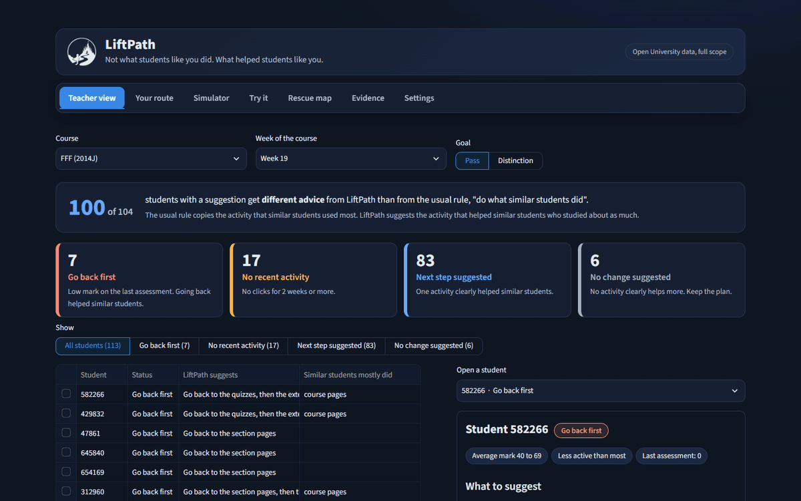
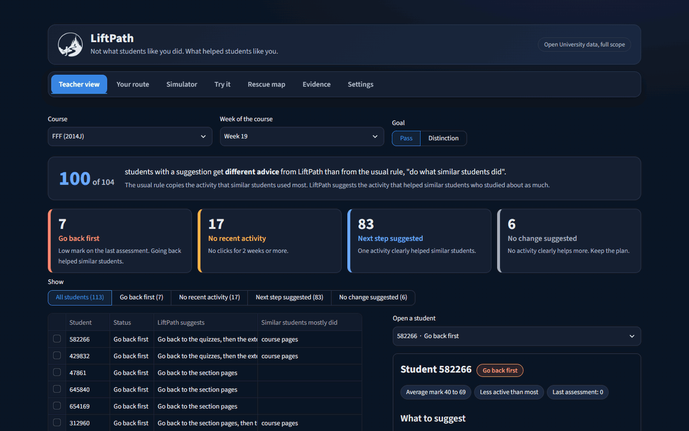
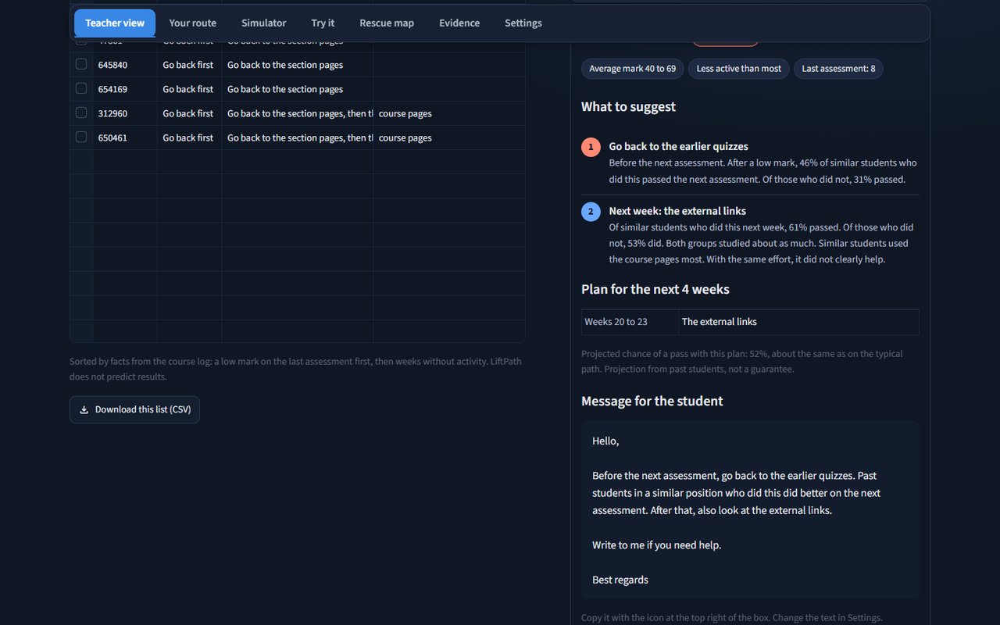
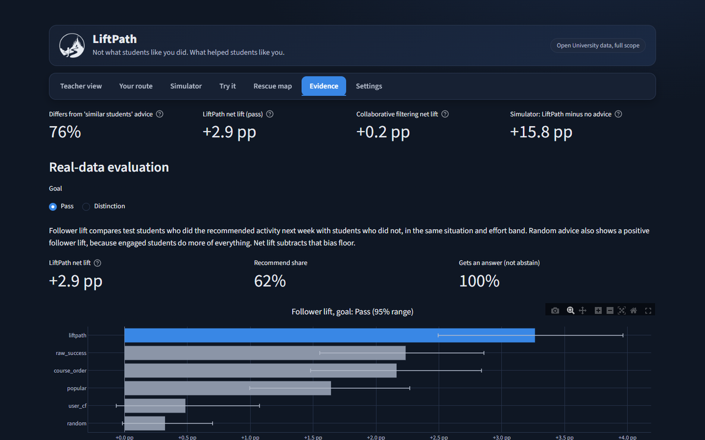
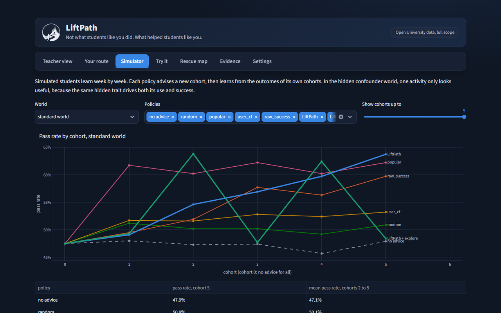
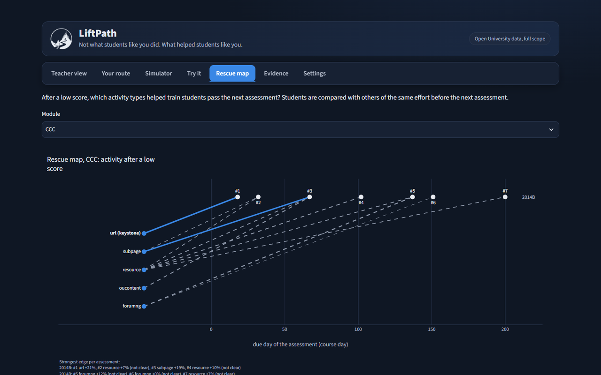
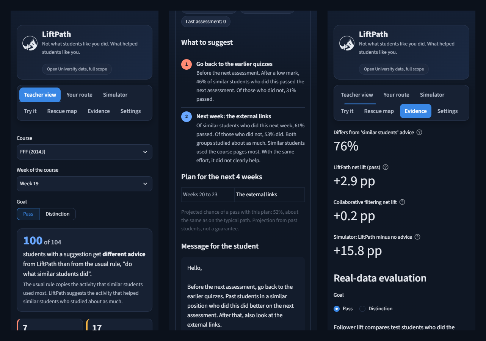
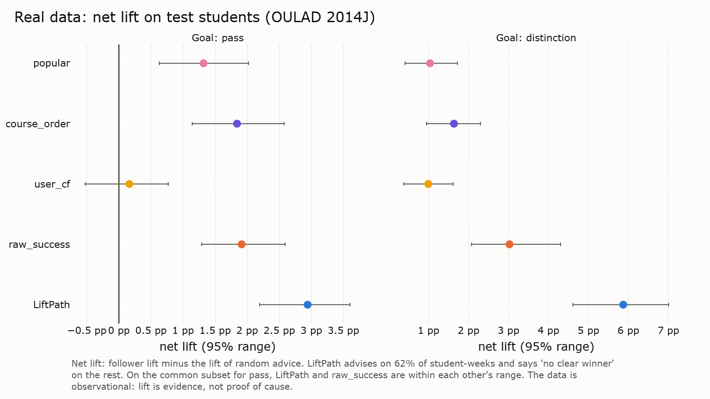

<p align="center">
  <picture>
    <source media="(prefers-color-scheme: dark)" srcset="app/static/logo_white.png">
    
  </picture>
</p>

# LiftPath

Not what students like you did. What helped students like you.

LiftPath recommends the next study activity for a student. It ranks each activity by its measured lift: the difference in goal rate between past students who did the activity next week and past students who did not. The two groups were in the same situation and studied about as much next week. LiftPath was built for the DataNova 2026 data-thon.

<p align="center"></p>

The teacher view opens first. It shows one next step for each student in plain words, the reason, a 4-week plan and a message to copy.

## Headline

Common advice and helpful advice differ for 76% of decisions. LiftPath advice: +2.9 points net lift. Collaborative filtering: +0.2.

The numbers come from `make headline` (`reports/headline.md`). The 76% is the share of 187,992 common test student-weeks where LiftPath and collaborative filtering give different activities. Net lift is the follower lift minus the lift of random advice, on test students, for the goal "pass".

The app runs on your computer. The steps are in [Quick start](#quick-start).

## Screenshots

A tour of the seven tabs:

<p align="center"></p>

<table>
<tr>
<td width="50%"><br>One student: the steps, the plan and the message.</td>
<td width="50%"><br>Evidence: the headline numbers and the lift of each method.</td>
</tr>
<tr>
<td width="50%"><br>Simulator: synthetic students with a known truth.</td>
<td width="50%"><br>Rescue map: what helped after a low score.</td>
</tr>
</table>

The app also works at phone width:

<p align="center"></p>

## Features

- Teacher view: the first tab. A class list with one next step per student in plain words, the reason, a 4-week plan and a message to copy. A card shows for how many students LiftPath differs from "do what similar students did". The numbers stay behind "Show the evidence". Guide: `docs/teacher_guide.md`.
- Dark theme with the LiftPath logo, a tab bar that stays at the top, and a loading screen on first open. Slide figures stay light.
- Settings: teacher preferences (course, goal, activity names, message text, the weeks without clicks before "No recent activity"), and the course rules and fixed rules from `config.yaml`, read only. Setup for your own data: `docs/admin_guide.md`.
- Your route: a plan for the next 4 weeks, with a lift and a 95% range for each step, a projected chance of the goal, and the typical path for comparison.
- Rescue card: after a low score, the earlier material that helped similar students pass the next assessment.
- Trap comparison: what "similar students" advice and "successful students" advice say for the same student, with the measured lift of each.
- Simulator: synthetic students with a known truth. It shows which advice helps, and how a loop that explores learns from its own advice.
- Try it: a demo mode where you add a student, log activity and scores, and get advice. The data resets on restart.
- Rescue map: a graph of the activity types that helped after a low score, per assessment.
- Evidence: real-data evaluation, fairness by group, and a test against a known answer.
- Engine CLI: `liftpath recommend` and `liftpath route` print strict JSON for other systems.

## How it works

1. Each student-week is a decision point. The state is the module, the week block, the score band so far and the effort band this week.
2. For each activity, LiftPath compares students in the same state who did the activity next week with students who did not. The comparison is made inside each next-week effort band, so "engaged students do more of everything" does not count as lift.
3. A smoothed difference in goal rate per effort band gives the lift. A bootstrap over students gives the 95% range.
4. LiftPath recommends an activity only if its range is above zero and both groups have enough students. If the most specific state has too little data, it backs off to a wider state. Else it says "no clear winner".
5. The route repeats this step for 4 weeks. Score transitions of past students project the next state, and the projected goal rate compares the route with the typical path.

The full method is in `docs/method.md`.

## Results

Real data: OULAD, train on the other presentations (2013B, 2013J, 2014B), test on the seven 2014J presentations (10,203 test students). Goal: pass.

| recommender | coverage | follower lift | net lift | 95% range of net lift |
|---|---|---|---|---|
| random | 100.0% | +0.3 pp | +0.0 pp | +0.0 to +0.0 pp |
| popular | 100.0% | +1.6 pp | +1.3 pp | +0.6 to +2.0 pp |
| course_order | 97.9% | +2.2 pp | +1.8 pp | +1.1 to +2.6 pp |
| user_cf | 97.9% | +0.5 pp | +0.2 pp | -0.5 to +0.8 pp |
| raw_success | 100.0% | +2.2 pp | +1.9 pp | +1.3 to +2.6 pp |
| LiftPath | 61.8% | +3.3 pp | +2.9 pp | +2.2 to +3.6 pp |

- LiftPath gives an activity for 61.8% of test student-weeks and says "no clear winner" for the rest. On the common subset where every method gives an activity, the net lift is +3.0 pp for LiftPath and +0.1 pp for user_cf.
- For the pass goal, LiftPath does not beat raw_success on the common subset: the difference is +0.3 pp (95% range -0.5 to +1.2 pp). For the distinction goal, LiftPath has +5.9 pp net lift and raw_success +3.0 pp.
- Simulator, cohort 5: LiftPath minus no advice is +15.8 pp in the standard world and +9.1 pp in the hidden confounder world. The means over cohorts 2 to 5 are +11.7 pp and +6.2 pp. The popular policy has the best mean in both worlds, because in this synthetic world the most used activity is also the only helpful one.

<p align="center"></p>

Full reports: `reports/eval.md`, `reports/fairness.md`, `reports/headline.md`. Slide figures: `reports/slides/`.

## Quick start

You need Python 3.12, [uv](https://docs.astral.sh/uv/), GNU make and Google Chrome (the figure export renders with Chrome).

```sh
make setup      # create the environment
make all        # download OULAD and build everything (about 5 min, plus the download on the first run)
make test       # run the tests
make app        # start the app at http://localhost:8501
```

The app runs from the committed files in `data/app/`. To start only the app on a new clone, run `make setup` and `make app`.

Single steps: `make data`, `make states`, `make lifts`, `make recover`, `make eval`, `make plan`, `make rescue`, `make sim`, `make app-data`, `make headline`, `make figures`. Set `DATA_SCOPE=sample` or `DATA_SCOPE=synthetic` to build a smaller scope.

## Engine CLI

```sh
uv run liftpath recommend --module GGG --week 1 --score-band none --effort-band mid --goal pass --json
uv run liftpath route --module GGG --week 3 --score-band mid --effort-band mid --goal distinction --json
```

Score bands: none, low, mid, high. Effort bands: none, low, mid, high. The output is strict JSON. The field `tables` tells if the advice used the live tables from demo mode or the committed app tables.

## Data and license

LiftPath uses the Open University Learning Analytics Dataset (OULAD), license CC BY 4.0.

Kuzilek J., Hlosta M., Zdrahal Z. "Open University Learning Analytics dataset." Scientific Data 4, article 170171, 2017. DOI [10.1038/sdata.2017.171](https://doi.org/10.1038/sdata.2017.171).

`make data` downloads the dataset from the UCI Machine Learning Repository. The committed app data holds no counts below 5 and no student outcomes. Details: `docs/datasheet.md`.

## Limitations

- The data is observational. Lift is evidence, not proof of cause.
- Effort control removes "how much" bias, not all bias. On synthetic data, the forum (no true effect) gets a higher pooled lift than quizzes (the true effect), because forum use still rises with effort inside an effort band.
- Scores count from the later of the submit day and the due day. Real marking takes longer.
- Activity types are coarse. Some activities are not open every week.
- The data comes from one university, in 2013 and 2014.
- LiftPath compares several activities per state. Some winners can be chance results.
- Rescue map: a shuffle test gives 2 or more solid edges in 19% of runs, so the 2 solid edges can be chance.
- Simulator: the explore loop wins in the hidden confounder world only because its experimental estimate sits above the true effect.
- Fairness: the lift is positive for every group with 200 or more students, except students with an unknown deprivation band (-0.9 pp, 95% range -3.2 to +1.7 pp).

LiftPath supports decisions. It does not make them. The model card is in `docs/model_card.md`.

## Project structure

```
app/streamlit_app.py     the app (7 tabs)
src/liftpath/            the package: states, lift, recommend, route, sim, rescue, live, engine
scripts/                 download, demo, headline and figure scripts
tests/                   pytest tests
config.yaml              all thresholds
data/app/                committed app data (counts below 5 suppressed)
reports/                 evaluation reports, figures and slide figures
docs/                    method, model card, datasheet, slides outline, demo script,
                         teacher guide, administrator guide
docs/media/              README screenshots and GIFs (captured from the running app)
SPEC.md                  the exact rules
PROGRESS.md              build log, decisions and results
```

## Credits

Bhargavaram Krishnapur, PulseEngine.

## License

MIT. See `LICENSE`. The OULAD data has its own license (CC BY 4.0).
